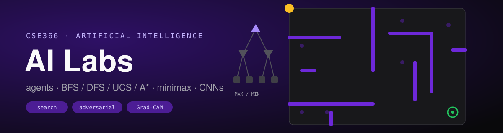

<p align="center">
  
</p>

# 🤖 CSE366 · Artificial Intelligence Labs

Lab work for **CSE366 (Artificial Intelligence)**, from simple agents to search, adversarial games and deep learning.

| Lab | Topic | Main files |
|---|---|---|
| [Lab 1](Lab%201/) | Random viva selection: file I/O, lists and random choice | `viva_selection.py` |
| [Lab 2](Lab%202/) | Trading agent that manages smartphone stock and pricing | `TradingAgent.py`, `TradingAgent.ipynb` |
| [Lab 3](Lab%203/Pacman/) | Maze search with BFS, DFS, UCS and A* on the Berkeley Pacman framework | `Pacman/` |
| [Lab 6](Lab%206/AI_Lab_06_Adversial_Search/) | Adversarial search: reflex, minimax, alpha-beta and expectimax agents | `multiAgents.py` |
| [Lab 7](Lab%207/) | CNN image classification with Grad-CAM explanations | `CSE366_LAB07_2022_1_60_130.ipynb` |

Each lab folder has its own README with details and results where available.

## Run

```bash
# Lab 1
cd "Lab 1" && python viva_selection.py

# Lab 6: try the minimax agent
cd "Lab 6/AI_Lab_06_Adversial_Search"
python pacman.py -p MinimaxAgent -l minimaxClassic -a depth=4
```

Notebooks (Labs 2 and 7) run in Jupyter or Google Colab.

## Credits

The Pacman projects (Labs 3 and 6) build on the [UC Berkeley CS188 Pacman AI projects](http://ai.berkeley.edu), using a Python 3 port.
